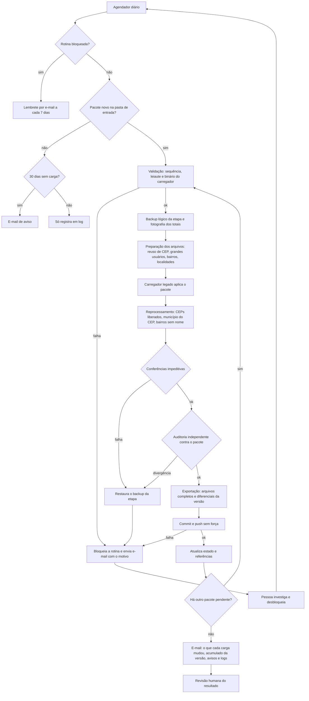

# Estudo de caso: automação das cargas quinzenais de CEP

Como uma atualização manual, irregular e sujeita a perdas silenciosas virou uma rotina diária que aplica, confere, exporta e publica cada pacote de CEPs sozinha, e para sozinha quando algo não fecha.

Por Guilherme Daflon. Este documento descreve a arquitetura e as decisões. Não contém código nem identificadores do ambiente em que a solução roda: nomes de servidores, bancos, tabelas e sistemas foram trocados por termos genéricos, e os números estão arredondados.

## 1. Contexto: o problema antes da automação

Um sistema corporativo mantém uma base de endereçamento com cerca de 1,6 milhão de CEPs, 5,6 mil municípios e 11,5 mil localidades. A fonte é o diretório nacional de endereços dos Correios, distribuído em dois formatos: um pacote completo, publicado de tempos em tempos, e pacotes delta quinzenais, com inclusões, alterações e exclusões.

A base serve a dois públicos. O primeiro é o próprio ambiente de desenvolvimento, de onde saem os arquivos de dados versionados junto com o produto. O segundo são as instalações dos clientes, que recebem a base completa na implantação e os diferenciais a cada versão.

Antes da automação, o processo era assim:

- Uma pessoa baixava os pacotes no portal da fonte, copiava para o servidor e executava uma sequência de scripts avulsos, um por tipo de arquivo.
- O programa que aplica os arquivos na base (aqui chamado de carregador legado) era um binário antigo, sem testes, usado como caixa-preta.
- A exportação para o controle de versão e a montagem dos diferenciais eram feitas à mão.
- Não havia conferência do resultado contra o pacote de origem. O critério de sucesso era o programa terminar sem erro.

Na prática, os deltas não eram aplicados com regularidade. Havia mais de um ano de pacotes acumulados, alguns já ausentes do disco, e uma tentativa anterior de colocar a base em dia tinha sido encerrada sem aplicar nenhum delta.

Não existe medição do tempo manual gasto antes. O que se sabe: só a carga completa ocupa cerca de 50 minutos de máquina, e o trabalho em volta dela (descobrir a sequência correta de pacotes, executar, conferir, exportar, versionar) dependia de uma pessoa com conhecimento que não estava escrito em lugar nenhum.

Os riscos eram maiores que o custo de tempo:

| Risco | O que foi encontrado |
|---|---|
| Perda silenciosa de registros | O carregador apagava o próprio registro em certas alterações e ainda contava a operação como sucesso |
| Dados incompletos | CEPs novos sem município e sem nome de bairro |
| Dados errados | Município novo criado com o nome de um distrito; exclusão de localidade que apagava o município |
| Sequência errada de pacotes | O pacote completo mais antigo não podia ser ponto de partida, porque faltavam deltas depois dele |
| Ausência de volta | Nenhum backup por etapa e nenhum procedimento de restauração testado |

## 2. Visão geral da arquitetura

A solução é um conjunto de scripts de shell em volta do carregador, com estado em arquivos e publicação por Git. Não há serviço em execução permanente: um agendador chama a rotina uma vez por dia.

| Componente | Responsabilidade |
|---|---|
| Pasta de entrada | Recebe os pacotes baixados da fonte. A presença de um pacote novo é o gatilho |
| Orquestrador da rotina | Decide se há trabalho, mantém a trava de execução, chama as etapas em ordem, trata falha e bloqueio, envia o e-mail |
| Etapa de aplicação | Faz o backup da etapa, prepara os arquivos, chama o carregador na ordem correta e reprocessa os casos que dependem de ordem |
| Carregador legado | Programa compilado que lê os arquivos da fonte e grava na base. Tratado como dependência externa, com verificação de versão |
| Referência de donos de CEP | Arquivo mantido fora do banco que registra a qual entidade cada CEP pertence (logradouro, localidade, grande usuário ou caixa postal comunitária) |
| Auditoria independente | Reconstrói o estado esperado a partir do pacote e compara com a base, sem reutilizar a lógica da aplicação |
| Exportador | Gera os arquivos completos e os diferenciais da versão (inclusões, alterações, exclusões) |
| Publicador | Faz o commit e o push dos arquivos no repositório de dados do produto |
| Estado e referências | Arquivos que guardam o último pacote publicado, a versão aberta, as cargas da versão e as cópias de referência usadas nos diferenciais |
| Notificador | E-mail em HTML com o resumo, os números e os logs em anexo |
| Camada de operação supervisionada | Catálogo de procedimentos (instalar, ensaiar, rodar, desbloquear, ler estado) acionados com aprovação humana quando alteram algo |

Duas cópias de referência sustentam os diferenciais. Uma guarda o estado ao fim da versão anterior do produto, e contra ela são gerados os arquivos que os clientes aplicam. A outra guarda o estado da última publicação, e contra ela se calcula o que cada carga mudou.

### 2.1 Estrutura da solução

A organização abaixo é uma referência para replicar a solução, montada a partir dos componentes da tabela acima. Os nomes de pastas e arquivos são genéricos.

```text
rotina-cep/
├── rotina.sh                  orquestrador: trava, gatilho, ordem das etapas, bloqueio e e-mail
├── etapas/
│   ├── validar.sh             sequência do pacote, leiaute dos arquivos e versão do carregador
│   ├── backup.sh              backup lógico da base e fotografia dos totais
│   ├── restaurar.sh           volta ao backup e confere que os totais bateram
│   ├── preparar.awk           reuso de CEP, grandes usuários, bairros e localidades
│   ├── aplicar.sh             chama o carregador na ordem certa e reprocessa as recusas
│   ├── corrigir.sh            município do CEP, bairros sem nome, registros técnicos
│   ├── conferir.sh            conferências impeditivas
│   ├── auditar.awk            auditoria independente: recalcula o esperado a partir do pacote
│   ├── exportar.sh            arquivos completos e diferenciais da versão
│   └── publicar.sh            commit e push sem força, com uma nova tentativa
├── lib/
│   ├── estado.sh              leitura e gravação do estado
│   ├── log.sh                 logs por execução, apagados depois de 90 dias
│   └── email.sh               e-mail em HTML com resumo, avisos e logs anexos
├── operacao/                  procedimentos da execução supervisionada
│   ├── instalar.sh
│   ├── ensaiar.sh             percorre o fluxo sem alterar a base e sem publicar
│   ├── desbloquear.sh
│   └── status.sh
├── estado/
│   ├── ultimo-pacote          último pacote publicado
│   ├── versao-aberta          versão do produto em andamento
│   ├── cargas-da-versao       pacotes aplicados nesta versão
│   └── bloqueio               motivo do bloqueio, quando houver
├── referencias/
│   ├── donos-de-cep           a qual entidade cada CEP pertence
│   ├── bairros                nomes de bairro por estado da base
│   ├── versao-anterior/       base ao fim da versão anterior: origem dos diferenciais
│   └── ultima-publicacao/     base na última publicação: o que cada carga mudou
├── entrada/                   pacotes baixados da fonte
├── testes/
│   ├── rodar.sh               bateria com mais de 60 casos
│   └── casos/                 vetores reais de cada falha encontrada
└── config/                    credenciais fora dos scripts, permissão só do dono (fora do Git)
```

Para replicar em outro ambiente, o mínimo é:

1. Uma base relacional com utilitário de backup lógico pela linha de comando.
2. Um jeito de aplicar os arquivos da fonte na base (aqui, o carregador legado; pode ser um script de carga próprio).
3. Um repositório Git para os arquivos exportados e uma chave de publicação exclusiva da rotina.
4. Um agendador (uma execução diária basta) e um agente de e-mail no servidor.
5. A bateria de testes rodando na mesma implementação de shell e awk do servidor.

## 3. Fluxo ponta a ponta

### 3.1 Obtenção do arquivo

O download continua manual. O portal da fonte exige acesso autenticado e a automação dessa parte traria mais risco que ganho. A pessoa baixa o pacote e o coloca na pasta de entrada. A partir daí ninguém precisa executar nada.

### 3.2 Validação

Antes de tocar na base, a rotina confere:

- se o nome do pacote segue a convenção da fonte (ano, mês e quinzena) e se ele é exatamente o próximo da sequência; pacote fora de ordem é recusado;
- se os arquivos internos têm o leiaute esperado, com a quantidade certa de campos por tipo;
- se o carregador instalado é uma versão aceita. Se o binário mudou desde a última execução, a rotina guarda uma cópia congelada e só segue se ele oferecer o modo de operação exigido.

### 3.3 Carga completa e carga delta

São dois caminhos com o mesmo esqueleto (backup, aplicação, conferência, registro de estado).

A carga completa limpa as tabelas de CEPs e de localidades, preserva a de municípios e recarrega tudo. Ela é usada para refazer a base a partir de um ponto confiável. A escolha desse ponto foi a primeira decisão do projeto: o pacote completo mais recente, seguido de todos os deltas posteriores a ele. Um detalhe da fonte que custou uma rodada de teste: o pacote completo ocupa o lugar de um delta na sequência, mas não contém o delta que leva o mesmo número.

A carga delta aplica um pacote quinzenal. É o caminho do dia a dia.

### 3.4 Reuso de CEP

Foi o problema mais difícil. A fonte reutiliza CEPs: no mesmo pacote, um logradouro deixa um CEP e outro logradouro passa a usá-lo. O carregador processa os arquivos por tipo de operação (exclusões, depois inclusões, depois alterações), então a inclusão do novo dono chega quando o CEP ainda está ocupado pelo antigo, e é recusada.

A solução foi tornar a posse de cada CEP um dado explícito:

```text
referência de donos: CEP -> (tipo da entidade, identificador na fonte)

para cada alteração de logradouro no pacote:
    se o destino não existe na base: tratar como inclusão
    se o CEP anterior pertence comprovadamente a este logradouro
       e o destino já foi gravado
       e nenhuma outra alteração aponta para o CEP anterior:
        liberar o CEP anterior
reprocessar as inclusões recusadas cujos CEPs foram liberados
se ainda restar inclusão recusada: conflito, a etapa falha
```

"Comprovadamente" é a palavra que importa. A remoção de um CEP só acontece quando a referência diz que ele pertence à entidade que está saindo. Sem essa prova, o registro é preservado e listado para análise.

### 3.5 Grandes usuários e caixas postais comunitárias

Esses dois tipos têm um caso especial: a alteração em que o CEP anterior é igual ao novo. O carregador excluía o anterior e depois atualizava o novo, ou seja, apagava o próprio registro. Em seis deltas isso representava cerca de 200 registros perdidos, todos contados como "atualizados".

A contenção foi preparar os arquivos antes de entregá-los ao carregador: quando o anterior é igual ao novo, o campo do anterior segue vazio; exclusão de CEP que pertence a outro dono não é enviada. Depois da aplicação, o que estava previsto e não entrou é reprocessado como inclusão.

### 3.6 Bairros

Dois problemas distintos:

- O arquivo de bairros do delta não era processado, porque o programa procurava a operação no lugar errado da linha.
- CEP novo era gravado sem o nome do bairro, e a rotina que preenchia o nome copiava de outro CEP do mesmo bairro. Quando não havia outro, gravava vazio.

A rotina mantém uma referência de bairros versionada pelo estado da base (completa mais deltas aplicados) e recarrega os bairros que ficaram sem nome. A conferência é impeditiva: a quantidade de CEPs com bairro sem nome não pode aumentar.

### 3.7 Municípios e localidades

- Um CEP novo era incluído sem o código do município. Um passo de correção roda ao fim de toda carga, e CEP sem município impede a etapa.
- Um município novo era criado com o nome da primeira linha do cadastro oficial, que podia ser um distrito. As sedes passaram a ser processadas primeiro.
- A exclusão de uma localidade apagava o município e a passada seguinte o recriava com outra chave. Nenhum pacote processado até aqui trouxe esse caso; o defeito foi para a especificação de correção do carregador.
- Localidade sem CEP gerava um registro técnico com CEP negativo. Registros técnicos são removidos e CEP zero na base impede a etapa.

### 3.8 Backup e restauração

Cada etapa começa com um backup lógico da base e uma fotografia dos totais. Se qualquer conferência falhar, a rotina restaura o backup, confere que os totais voltaram ao valor de antes, grava o estado de bloqueio com o motivo e para.

A restauração foi testada de propósito: um delta foi interrompido no meio, a rotina recusou a continuação, restaurou, e a base e as referências ficaram idênticas ao estado anterior, comparadas por hash.

### 3.9 Auditoria contra a fonte

Depois da aplicação roda uma auditoria que não compartilha código com ela. Ela lê o pacote, calcula o que deveria existir e o que deveria ter saído, e compara com a base nos dois sentidos: o que falta e o que sobra.

Foi essa auditoria que reprovou a quinta rodada de testes. Todas as conferências próprias da aplicação estavam limpas, e mesmo assim os cerca de 200 registros de grandes usuários não estavam na base. A lição: uma conferência escrita por quem escreveu a carga herda os mesmos pontos cegos.

Além da auditoria, a base tem que convergir com a referência de donos. Divergência em qualquer direção impede a etapa.

### 3.10 Exportação

Com a base conferida, a rotina gera:

- os arquivos completos de cada tabela. O de CEPs é dividido em duas metades por causa do tamanho;
- os diferenciais da versão aberta do produto: inclusões, alterações e exclusões de CEPs e de municípios.

Os diferenciais são calculados sempre contra o estado publicado ao fim da versão anterior. Se chegam duas cargas na mesma versão, a segunda regera os arquivos com a soma das duas. O cliente aplica um único conjunto por versão, na ordem exclusões, inclusões, alterações.

### 3.11 Publicação e aprovação humana

A rotina faz o commit e o push direto no ramo principal do repositório de dados, sem forçar. Se o ramo andou entre o fetch e o push, ela tenta uma vez mais. Se falhar de novo, bloqueia.

A decisão humana ficou em três pontos, e nenhum deles é um clique de "aprovar" no meio do fluxo:

1. Antes: a pessoa escolhe quando colocar o pacote na pasta de entrada.
2. Depois: o e-mail traz o que mudou, os avisos que precisam de conferência e os logs. Quem recebe revisa o resultado já publicado.
3. Na falha: a rotina não tenta de novo sozinha. Só uma pessoa desbloqueia, depois de entender o motivo.

Durante a construção o controle foi mais rígido. A carga na base real só foi autorizada depois de a sequência inteira passar em uma cópia isolada, e cada execução que alterava algo exigia aprovação explícita.

## 4. Agendamento e gatilhos

| O que | Quando | Efeito |
|---|---|---|
| Execução da rotina | Todo dia, de manhã, pelo agendador do sistema | Verifica a pasta de entrada |
| Pacote novo na pasta | Detectado na execução diária | Dispara a aplicação, em ordem, de todos os pacotes pendentes |
| Nenhum pacote novo | Execução diária | Só registra em log, sem e-mail |
| 30 dias sem carga nova | Execução diária | E-mail de aviso, repetido a cada 30 dias |
| Rotina bloqueada | Execução diária | Não processa nada; lembra por e-mail a cada 7 dias |
| Ensaio | Sob demanda | Percorre o fluxo sem alterar a base e sem publicar; termina com um indicador de sucesso ou com o motivo da falha |
| Desbloqueio | Sob demanda, por uma pessoa | Libera a rotina para a próxima execução |

Os logs são apagados depois de 90 dias.

## 5. Mecanismos de segurança

**Interrupção.** Uma trava de execução impede duas rotinas ao mesmo tempo. Se a execução anterior morreu no meio, a seguinte encontra a etapa incompleta, recusa continuar e restaura. Travas do Git deixadas por processo interrompido são limpas, e as operações de rede têm tempo máximo.

**Rollback.** Backup lógico por etapa, restauração automática na falha e conferência dos totais depois da restauração.

**Idempotência.** O estado publicado é a fonte da verdade. Um pacote já publicado não é reaplicado, só o próximo da sequência é aceito, e os diferenciais da versão são regerados do zero a cada carga, a partir da mesma referência. Rodar duas vezes produz o mesmo resultado.

**Falha fechada.** Qualquer conferência que não fecha bloqueia a rotina. Não existe nova tentativa automática, porque uma falha aqui quase nunca é transitória.

**Conferências impeditivas.**

- CEP sem município.
- CEP zero ou negativo na base.
- Aumento de CEPs com bairro sem nome.
- Registro previsto no pacote e ausente na base.
- Registro presente na base e ausente da referência de donos, ou o contrário.
- Inclusão recusada que não foi resolvida pelo reprocessamento.
- Leiaute do arquivo diferente do esperado.

**Integridade das ferramentas.** O binário do carregador é identificado por hash antes de cada chamada. Em uma das rodadas de teste ele foi republicado por fora entre duas etapas, e a conferência pegou.

**Credenciais.** A credencial do banco e a chave de publicação ficam em uma pasta separada, com permissão restrita ao dono. Nada fica em texto dentro dos scripts. A chave de publicação é exclusiva da rotina.

**Limpeza.** O comando de remoção do ambiente tem comportamento fora do padrão com nomes que contêm espaço ou curinga. A limpeza renomeia antes o que tem nome inseguro e aborta se a renomeação falhar.

## 6. Stack e ferramentas

| Camada | Ferramenta |
|---|---|
| Orquestração | Shell (bash), agendador do sistema operacional |
| Transformação de arquivos | awk e os utilitários de texto do sistema |
| Base de destino | Banco relacional, com os utilitários de linha de comando do próprio banco para consulta e backup lógico |
| Aplicação dos arquivos | Carregador legado (binário compilado), tratado como dependência |
| Publicação | Git por SSH, com chave exclusiva |
| Notificação | Agente de e-mail do servidor, mensagem em HTML com texto alternativo e anexos |
| Integridade | SHA-256 para binário, backups, referências e pacotes de entrega |
| Testes | Bateria em shell com mais de 60 casos, incluindo os vetores reais que causaram cada falha |

O ambiente impôs restrições que moldaram o código: uma implementação antiga do awk, sem as extensões mais comuns; arquivos da fonte com delimitador próprio, quebra de linha de Windows e codificação latina; e um limite de tamanho nos parâmetros aceitos pelo carregador. A bateria de testes roda na mesma implementação do awk que existe no servidor.

### Onde a IA entrou

A construção usou dois assistentes de IA com papéis separados e uma pessoa decidindo.

- **Autor.** Um assistente (Claude) fez o diagnóstico a partir dos pacotes e do comportamento observado, escreveu os scripts, a bateria de testes e os documentos, incluindo a especificação de correção do carregador.
- **Revisor independente.** Outro assistente (Codex), sem acesso ao raciocínio do primeiro, leu o código-fonte do carregador para confirmar ou refutar cada hipótese, e executou as rodadas de teste em uma cópia isolada da base.
- **Execução supervisionada.** Nenhum dos dois tinha acesso livre ao servidor. As ações possíveis ficavam em um catálogo de procedimentos fixos. Leitura rodava direto; qualquer escrita abria um pedido que a pessoa aprovava fora da conversa.
- **Decisão.** Escolhas de negócio, autorização da carga real e desbloqueios ficaram sempre com a pessoa.

O que funcionou: a separação entre quem escreve e quem confere. A perda dos registros de grandes usuários passou por todas as conferências do autor e só apareceu na auditoria feita pelo revisor. A causa foi fechada com evidência (os arquivos da auditoria e o código do carregador).

O que não funcionou de primeira: as versões iniciais dos scripts passavam nos testes locais e falhavam no servidor, por diferenças de ambiente que só apareceram executando lá.

## 7. Decisões técnicas e trade-offs

**Envolver o carregador em vez de reescrevê-lo.** O carregador tinha vários comportamentos incompatíveis com a fonte. Reescrever exigia outro ciclo de desenvolvimento e homologação; contornar permitia colocar a base em dia agora. As contenções ficaram em volta do binário, e cada uma virou um item da especificação de correção. Quando o carregador corrigido foi publicado, com um modo único de atualização, a rotina passou a usá-lo. O custo dessa escolha foi manter, por um tempo, uma lógica frágil de pré e pós-processamento.

**Referência de donos fora do banco.** O banco guarda o CEP, mas não diz de quem ele é na fonte. Sem isso não dá para distinguir "CEP liberado" de "CEP de outro registro". Um arquivo de referência é simples de versionar, comparar por hash e restaurar junto com o backup. O custo é mais uma coisa que precisa convergir com a base, e por isso a convergência virou conferência impeditiva.

**Auditoria com implementação separada.** Custa escrever a regra duas vezes. Pagou o investimento na primeira vez em que discordou da aplicação.

**Falhar fechado.** Uma rotina que para e avisa incomoda mais que uma que tenta de novo. Mas todas as falhas vistas eram de dado ou de regra, e repetir só repetiria o erro.

**Diferencial por versão, não por carga.** Os clientes atualizam por versão do produto, então o arquivo que eles aplicam tem que ser o acumulado da versão. O efeito colateral apareceu no primeiro e-mail: a rotina informava "440 municípios alterados" a cada carga, e parecia que cada pacote mexia em 440 municípios. Era o acumulado da versão, quase todo correção de acentuação herdada de uma recarga. O e-mail passou a mostrar as duas coisas separadas: o que esta carga mudou e o acumulado da versão.

**Push direto no ramo principal.** A primeira versão publicava em um ramo e esperava merge manual. Na prática, isso recriava a dependência de uma pessoa lembrar. Como o conteúdo é gerado, auditado e reproduzível, a publicação passou a ser direta, sem força. O controle humano foi para antes (colocar o pacote) e para depois (revisar o e-mail). O risco aceito: um erro que passe por todas as conferências chega ao ramo principal sem revisão prévia.

**Download manual.** Automatizar o acesso ao portal significaria guardar uma credencial pessoal e depender de uma página que muda. Um passo manual de dois minutos, duas vezes por mês, foi considerado aceitável.

**Verificação diária em vez de evento.** Um observador de pasta seria mais um processo para manter vivo. Uma execução diária é simples, e o atraso máximo de um dia não importa para um dado quinzenal.

**E-mail só quando há o que dizer.** Mensagem diária de "nada novo" ensina as pessoas a ignorar o remetente. O silêncio prolongado, por outro lado, pode ser rotina parada, e por isso existe o aviso de 30 dias.

**Seguir o binário publicado.** Fixar o carregador por hash dava segurança e travava a rotina a cada nova publicação. A regra final: usar sempre o binário publicado, guardar uma cópia do que foi usado e exigir que ele ofereça o modo esperado.

## 8. Resultados

| | Antes | Depois |
|---|---|---|
| Aplicação dos deltas | Irregular; mais de um ano de pacotes acumulados | A cada pacote, na execução diária seguinte à chegada |
| Trabalho humano por carga | Execução manual de vários scripts e exportação à mão (tempo não medido) | Colocar o pacote na pasta e ler o e-mail |
| Tempo de máquina | Carga completa em cerca de 50 minutos; deltas sem medição | Carga completa em cerca de 50 minutos; delta em 10 a 15 minutos, mais auditoria e exportação |
| Conferência do resultado | Nenhuma além do retorno do programa | Conferências impeditivas e auditoria independente em toda carga |
| Volta em caso de falha | Não havia | Backup por etapa e restauração automática, testada |
| Publicação | Manual | Automática, com e-mail de resumo |

Volumes aproximados:

- Base: 1,6 milhão de CEPs, 5,6 mil municípios, 11,5 mil localidades.
- Primeira versão publicada pela rotina: 18 mil CEPs incluídos, 57 mil alterados e mil excluídos; 440 municípios alterados, dos quais cerca de 340 só na acentuação.
- A primeira carga quinzenal depois da instalação foi processada, auditada e publicada sem intervenção além do download.

Erros encontrados antes de chegarem à base real:

- cerca de 200 registros de grandes usuários que seriam apagados em seis deltas;
- uma dezena de CEPs que ficariam faltando em um único delta;
- mais de 250 CEPs que ficariam com o bairro sem nome;
- um município novo que seria criado com o nome de um distrito;
- um delta inteiro travado por três CEPs reutilizados dentro do próprio pacote.

O caminho até aí: sete versões dos scripts, ao longo de sete rodadas de revisão e de execução em cópia isolada.

## 9. Diagrama do fluxo


